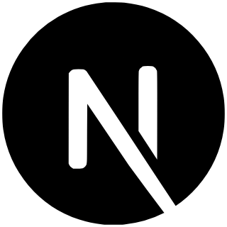

<h1 align="center">Nika Tsutskiridze</h1>

Mobile-first full-stack engineer building scalable, production-ready applications.

#

React Native • React • Node.js • Laravel • TypeScript

  &nbsp;&nbsp;
  &nbsp;&nbsp;
  &nbsp;&nbsp;
  &nbsp;&nbsp;
  

 

  &nbsp;&nbsp;
  &nbsp;&nbsp;
  &nbsp;&nbsp;
 &nbsp;&nbsp;

#

<h3 align="left">Contact me:</h3>

&nbsp;&nbsp;

 
